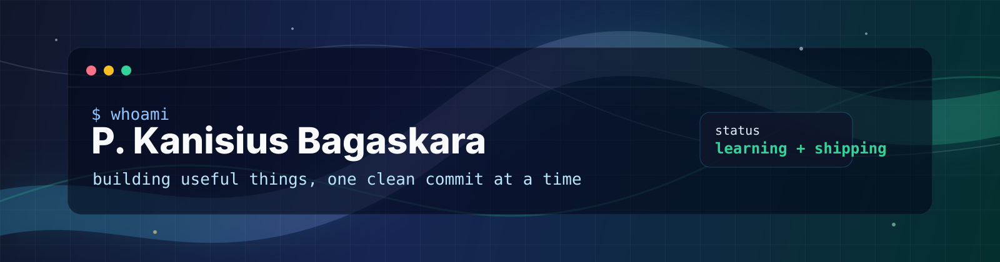

  

<h1 align="center">P. Kanisius Bagaskara</h1>

  <strong>AI/ML engineer in the making</strong> &middot; Tangerang, Indonesia 
  Building intelligent systems, useful tools, and products that actually ship.

  
  
  

---

### Focus

- **LLM infrastructure:** a local proxy and CLI that cuts token spend on coding agents without breaking the provider's prefix cache
- **Retrieval and agents:** RAG with citation checks, tool safety gates, and self-correcting loops
- **Machine learning fundamentals:** core algorithms implemented from scratch, plus fraud-risk modelling on the IEEE-CIS dataset
- **Product engineering:** Next.js and TypeScript apps, dashboards, and desktop tools

### Featured Projects

| Project | What it is | Stack |
| :--- | :--- | :--- |
| [aphelion-engine](https://github.com/knsiuss/aphelion-engine) | Local HTTP/SSE proxy and CLI for LLM coding agents. Freezes the prefix on turn 0, compacts only newly appended turns, and drops to pass-through when upstream cache-hit falls below 70%. Ships as one static binary plus an npm launcher. | Rust |
| [vektor](https://github.com/knsiuss/vektor) | Open-source, model-agnostic AI operations assistant. Chat over your own runbooks, hybrid RAG over uploaded documents, read-only tools behind a safety gate, and per-tenant usage metering. Early development (v0.1.0), Apache-2.0. | Python, FastAPI, Next.js |
| [agentic-rag-aphelion](https://github.com/knsiuss/agentic-rag-aphelion) | Design specification for a self-correcting RAG loop with dynamic sub-agent spawning: retrieval, critique, respawn, and observability. Spec first, ten documents, implementation not started. | Spec |
| [ieee-fraud-detection](https://github.com/knsiuss/ieee-fraud-detection) | Sentinel, a fraud-risk decisioning platform built on the IEEE-CIS dataset, with model training, a FastAPI service, and a Gradio interface. | Python, LightGBM |
| [Deep-Dive-into-ML](https://github.com/knsiuss/Deep-Dive-into-ML) | ML curriculum where every algorithm is implemented from scratch with the math worked out, built alongside Stanford CS229. | Python, Jupyter |
| [f1lab](https://github.com/knsiuss/f1lab) | Real-time F1 analytics dashboard with telemetry, race replay, and ML predictions. | Python, Streamlit, FastF1 |
| [sela](https://github.com/knsiuss/sela) | WhatsApp/SMS-first AI agent that books and reschedules appointments for SMB service businesses. | TypeScript |

Smaller tools on this account: [spotify-downloader](https://github.com/knsiuss/spotify-downloader), [sland](https://github.com/knsiuss/sland), [starstask](https://github.com/knsiuss/starstask), and [web-portfolio](https://github.com/knsiuss/web-portfolio).

### Tech Stack

**Languages**

  
  
  
  
  
  

**AI/ML & Data**

  
  
  
  
  
  
  
  

**Apps & Platforms**

  
  
  
  
  
  
  
  
  

### GitHub Activity

  
  

  

---

  <strong>Let's build something useful.</strong> 
  Always learning, always iterating, always making the next version cleaner.

